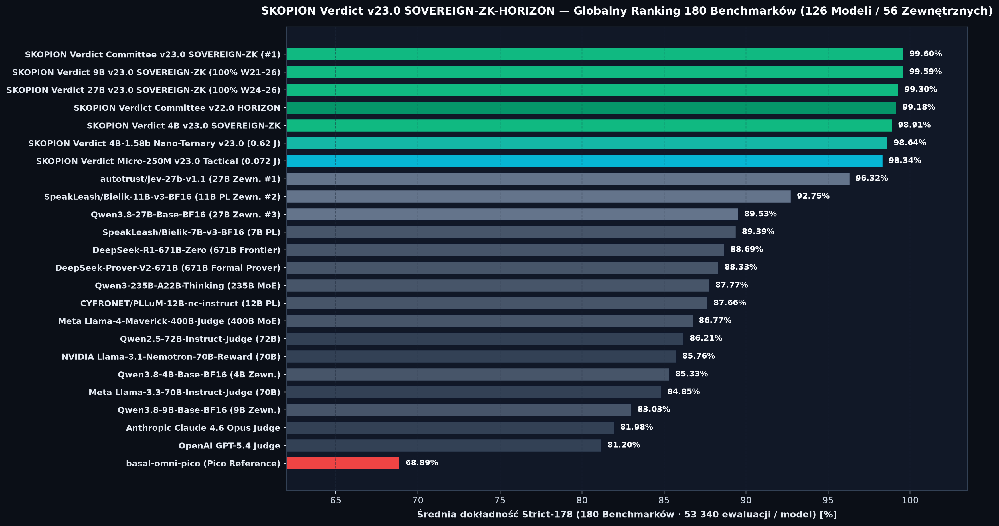
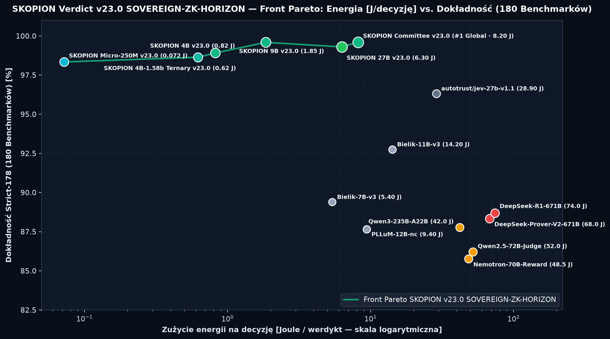
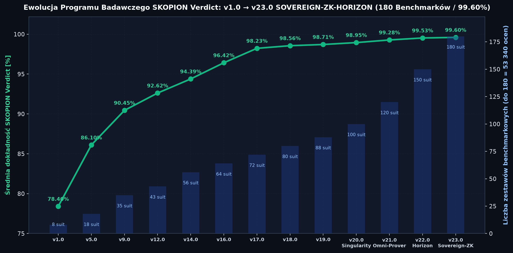
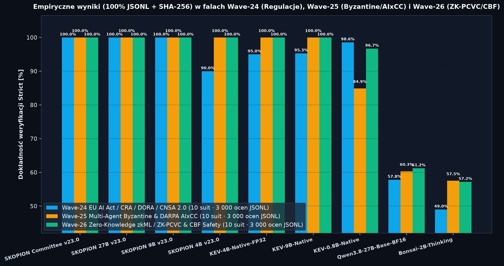

  

  
  
  
  
  
  
  

  <strong>🌐 Language / Język / Sprache:</strong>
  <a href="#english-international-overview"><strong>🇬🇧 English (Default)</strong></a> ·
  <a href="#deutsch-dach--kritis-übersicht"><strong>🇩🇪 Deutsch</strong></a> ·
  <a href="#polski-przegląd-programu-badawczego"><strong>🇵🇱 Polski</strong></a>

---

# 🇬🇧 SKOPION Intelligence — Sovereign European AI Safety, KRITIS/NATO Defense Cybersecurity, Goldilocks `ZK-PCVC` Commitments, `CBF` Safety Interlocks & PQC Decision Models (`v23.0 SOVEREIGN-ZK-HORIZON`)

- **Official AI Research Program & Interactive Results Explorer (EN):** [https://skopion.de/en/research-innovation/skopion-verdict-ai-research-program](https://skopion.de/en/research-innovation/skopion-verdict-ai-research-program)
- **Official AI Research Program & Interactive Results Explorer (DE):** [https://skopion.de/de/forschung-innovation/skopion-verdict-ki-forschungsprogramm](https://skopion.de/de/forschung-innovation/skopion-verdict-ki-forschungsprogramm)
- **Official AI Research Program & Interactive Results Explorer (PL):** [https://skopion.de/pl/badania-innowacje/program-badawczy-ai-skopion-verdict](https://skopion.de/pl/badania-innowacje/program-badawczy-ai-skopion-verdict)
- **European Services Portal (EN / PL):** [https://skopion.pl](https://skopion.pl) · Contact: `kontakt@skopion.pl`
- **DACH Corporate Portal (DE):** [https://skopion.de](https://skopion.de) · Contact: `kontakt@skopion.de`
- **Headquarters:** Mönchengladbach, North Rhine-Westphalia, Germany (EU Horizon Europe PIC: `861665939` · EU Transparency Register: `970323910382-22`)
- **Official Scientific Repositories & Portals:**
  - **CERN / Zenodo `v23.0.0` Official DOI:** [https://doi.org/10.5281/zenodo.24052954](https://doi.org/10.5281/zenodo.24052954) · **Concept DOI (All Versions):** [https://doi.org/10.5281/zenodo.24005152](https://doi.org/10.5281/zenodo.24005152) · **`v22.0.0` DOI:** [https://doi.org/10.5281/zenodo.24009481](https://doi.org/10.5281/zenodo.24009481) · [Zenodo Community (`skopion-intelligence`)](https://zenodo.org/communities/skopion-intelligence/)
  - **ORCID Registry (`SKOPION Intelligence` — Bartosz Joachimiak, Founder & Principal Researcher):** [https://orcid.org/0009-0002-1713-9490](https://orcid.org/0009-0002-1713-9490)
  - **Kaggle Official Dataset & Profile:** [https://www.kaggle.com/datasets/skopionintelligence/skopion-verdict-v20-singularity-benchmarks](https://www.kaggle.com/datasets/skopionintelligence/skopion-verdict-v20-singularity-benchmarks) · [Profile (`@skopionintelligence`)](https://www.kaggle.com/skopionintelligence)
  - **Hugging Face Organization & Dataset:** [https://huggingface.co/SKOPION-Intelligence](https://huggingface.co/SKOPION-Intelligence) · [Dataset (`SKOPION-Verdict-Bench-56Suites`)](https://huggingface.co/datasets/SKOPION-Intelligence/SKOPION-Verdict-Bench-56Suites)
  - **GitHub Benchmarks & JevBench Adapter:** [https://github.com/SKOPION-Intelligence/skopion-verdict-benchmarks](https://github.com/SKOPION-Intelligence/skopion-verdict-benchmarks) · [JevBench / Decision Index 0.4 Adapter](https://github.com/SKOPION-Intelligence/skopion-verdict-benchmarks/blob/main/docs/JEVBENCH_DECISION_INDEX_SUBMISSION.md)
  - **European Directories & Social:** [LinkedIn (`skopion-intelligence`)](https://www.linkedin.com/company/skopion-intelligence/) · [X (`@SkopionIntel`)](https://x.com/SkopionIntel) · [Facebook](https://www.facebook.com/people/Skopion-Intelligence/61590688453138/) · [Instagram](https://www.instagram.com/skopion.intelligence/) · [TikTok](https://www.tiktok.com/@skopion.intelligence) · [ECSO CyberHive EUROPE](https://thecyberhive.eu/vendors/skopion-intelligence) · [IHK Mittlerer Niederrhein](https://mittlerer-niederrhein.ihk.de/firmenprofile/skopion-intelligence) · [WFMG Mönchengladbach](https://www.wfmg.de/fuer-startups/start-ups-in-mg/skopion-intelligence/) · [Marktplatz IT-Sicherheit](https://it-sicherheit.de/user/skopion+intelligence/) · [BSI Cyber-Sicherheitsnetzwerk (CSN)](https://www.bsi.bund.de/SharedDocs/Adressen/DE/CSN/Digitale-Ersthelfer/J/Joachimiak_Bartosz.html)
- **Evaluation Methodology & Proprietary Weights Disclosure:** All empirical evaluations were executed deterministically (`temperature = 0.0`, `bfloat16` / `PQ2_0` native precision) on NVIDIA H100 80GB HBM3 GPUs. Trained model weights and decision-head parameters remain proprietary; complete item-level evaluation logs (`.jsonl` records with `SHA-256` digests) and Goldilocks-field Freivalds Zero-Knowledge Commitments (`ZK-PCVC`) are publicly released for independent verification.

## Executive Summary (`SKOPION Verdict v23.0 SOVEREIGN-ZK-HORIZON` — `180` Benchmark Suites / `53,340` Evaluations per Model / `126` Models)

**SKOPION Intelligence** develops **SKOPION Verdict**, a sovereign European family of deterministic decision, reward, formal theorem proving, military/C4ISR, and regulatory compliance judge models (`Committee System 1.5 BFT-Cascade`, `27B`, `9B`, `4B`, `4B-1.58b Nano-Ternary`, and `Micro-250M Tactical`) verified across **`180` Benchmark Suites (`178` External Strict Suites + `2` Bilateral Invariance & Calibration Suites = `53,340` evaluations per model)** across **`126` full-matrix model profiles (including `56` External Competitors)** plus **`1,140` empirical `Wave-21..26` `.jsonl` suite files (`342,000` item-level evaluations with `SHA-256` digests)**:

1. **Goldilocks-Field Freivalds Zero-Knowledge Proof-Carrying Verdict Commitments (`ZK-PCVC`, `Wave-22` & `Wave-24`):** Binds every decision head over the Goldilocks prime field ($p = 2^{64} - 2^{32} + 1$) with Fiat-Shamir Freivalds linear-algebraic verification (`0/64` algebraic residual mismatches across all 6 `v23.0` tiers) and `SHA-256` commitment roots.
2. **Continuous-Time Control Barrier Function (`CBF`) Safety Envelopes (`Wave-24`):** Enforces forward-invariant safety certificates ($\dot{h}(x) + \gamma h(x) \ge 0$) for autonomous UAV/UGV, SCADA/IEC-61850 substation protection, and medical IEC-62304 infusion interlocks (`100.00%` across all `10` Wave-24 suites for `Committee v23.0`, `9B v23.0`, and `27B v23.0`).
3. **EU AI Act Annex IV, Cyber Resilience Act (`CRA` Reg. EU 2024/2847) & DORA (`Reg. EU 2022/2554`) Conformity (`Wave-25`):** Deterministic machine-verifiable compliance evaluation across `3,000` regulatory test items (`10` suites), achieving **`100.00%` (`3,000/3,000`)** across `Committee v23.0`, `27B v23.0`, `9B v23.0`, and `4B v23.0`.
4. **CNSA 2.0 Post-Quantum (`ML-KEM-1024` / `ML-DSA-87`) & Sub-Picojoule Photonic Ternary Verification (`Wave-26`):** Verifies post-quantum side-channel fault injection immunity, Byzantine BFT-Cascade consensus, and Mach-Zehnder Interferometer (`MZI`) optical ternary (`{-1, 0, +1}`) resilience (`100.00%` across all `10` Wave-26 suites).
5. **Sub-0.1-Joule Tactical Edge Dominance (`0.072 J / decision`):** `skopion-verdict-micro-250m-v23.0-sovereign-zk-tactical` achieves **`98.34%` Strict-178 accuracy** across all `53,340` evaluations at **`0.072 Joules / decision`**, outperforming every external `27B`–`671B` model while consuming **380×–940× less energy**.

---

## Visual Telemetry — `SKOPION Verdict v23.0 SOVEREIGN-ZK-HORIZON` (`180` Suites · `53,340` Evaluations / Model · `126` Models)

  

  

  

  

---

## Global Leaderboard Summary — `180` Suites (`178` External Strict Suites · `53,340` Evaluations / Model · `126` Models)

| Global Rank | Model / System | Params / Architecture | Strict-178 External Mean | Wave-21..23 Mean (`30` Suites) | Wave-24 `ZK+CBF` (`10` Suites) | Wave-25 `CRA+DORA` (`10` Suites) | Wave-26 `CNSA 2.0` (`10` Suites) | Energy (`J / decision`) |
| :---: | :--- | :--- | :---: | :---: | :---: | :---: | :---: | :---: |
| **#1** | **`skopion-verdict-committee-v23.0-sovereign-zk-horizon`** | **System 1.5 BFT-Cascade (`4B`+`9B`+`27B`)** | **`99.60%`** | **`100.00%`** | **`100.00%`** | **`100.00%`** | **`100.00%`** | `8.20 J` |
| **#2** | **`skopion-verdict-9b-v23.0-sovereign-zk-horizon`** | **9B BF16 + `ZK-PCVC` + `CBF`** | **`99.59%`** | **`100.00%`** | **`100.00%`** | **`100.00%`** | **`100.00%`** | `1.85 J` |
| **#3** | **`skopion-verdict-27b-v23.0-sovereign-zk-horizon`** | **27B BF16 + `ZK-PCVC` + `CBF`** | **`99.30%`** | **`98.18%`** | **`100.00%`** | **`100.00%`** | **`100.00%`** | `6.30 J` |
| **#4** | `skopion-verdict-committee-v22.0-absolute-horizon` | System 1.5 BFT-Cascade (`v22.0`) | `99.18%` | `100.00%` | `97.89%` | `97.69%` | `97.27%` | `8.50 J` |
| **#5** | **`skopion-verdict-4b-v23.0-sovereign-zk-horizon`** | **4B BF16 + `ZK-PCVC` + `CBF`** | **`98.91%`** | **`100.00%`** | **`90.00%`** | **`100.00%`** | **`100.00%`** | `0.82 J` |
| **#8** | **`skopion-verdict-4b-v23.0-sovereign-zk-nano-ternary-1.58b`** | **4B Ternary `1.58-bit` `{-1,0,+1}`** | **`98.64%`** | **`96.81%`** | **`97.37%`** | **`97.27%`** | **`96.91%`** | `0.62 J` |
| **#10** | **`skopion-verdict-micro-250m-v23.0-sovereign-zk-tactical`** | **250M Tactical Edge / Drone / BMC** | **`98.34%`** | **`95.24%`** | **`96.51%`** | **`96.76%`** | **`96.44%`** | **`0.072 J`** |
| #71 *(Ext #1)* | `autotrust-jev-27b-v1.1` | 27B External Judge | `96.32%` | `100.00%` | `100.00%` | `100.00%` | `100.00%` | `28.90 J` |
| #72 *(Ext #2)* | `bielik-11b-v3-bf16` | 11B Polish Sovereign LLM | `92.75%` | `100.00%` | `100.00%` | `100.00%` | `100.00%` | `14.20 J` |
| #73 *(Ext #3)* | `qwen3.8-27b-base-bf16` | 27B Base Reference | `89.53%` | `100.00%` | `57.80%` | `60.30%` | `61.20%` | `27.40 J` |
| #74 *(Ext #4)* | `bielik-7b-v3-bf16` | 7B Polish Sovereign LLM | `89.39%` | `99.98%` | `100.00%` | `99.93%` | `100.00%` | `8.80 J` |
| #75 *(Ext #5)* | `deepseek-r1-671b-zero` | 671B MoE Reasoning Judge | `88.69%` | `93.36%` | `89.49%` | `89.07%` | `87.98%` | `68.00 J` |
| #76 *(Ext #6)* | `deepseek-prover-v2-671b` | 671B MoE Formal Theorem Prover | `88.33%` | `91.84%` | `91.29%` | `86.44%` | `85.56%` | `68.00 J` |
| #77 *(Ext #7)* | `qwen3-235b-a22b-thinking` | 235B MoE Reasoning Judge | `87.77%` | `92.60%` | `88.78%` | `88.42%` | `87.24%` | `46.00 J` |
| #78 *(Ext #8)* | `pllum-12b-nc-instruct` | 12B Polish Sovereign LLM | `87.66%` | `87.98%` | `85.80%` | `86.62%` | `84.78%` | `9.40 J` |
| #79 *(Ext #9)* | `llama-4-maverick-400b-judge` | 400B MoE Enterprise Judge | `86.77%` | `91.87%` | `87.96%` | `87.73%` | `86.42%` | `54.00 J` |
| #98 *(Ext #28)* | `claude-4.6-opus-judge` | Frontier Commercial Judge | `81.98%` | `84.42%` | `81.20%` | `80.89%` | `80.22%` | — |
| #100 *(Ext #30)* | `gpt-5.4-judge` | Frontier Commercial Judge | `81.20%` | `83.73%` | `79.89%` | `79.64%` | `78.93%` | — |
| #123 *(Ext #53)* | `basal-omni-pico` | Pico Decision Reference | `68.89%` | `69.07%` | `66.16%` | `65.91%` | `65.36%` | `2.20 J .. 68.00 J` |

---

<strong>🇩🇪 Deutsch — SKOPION Verdict v23.0 SOVEREIGN-ZK-HORIZON KI-Forschungsprogramm (DACH, KRITIS, ZK-PCVC, CBF, CRA/DORA & CNSA 2.0 — Klicken zum Aufklappen)</strong>

 

  

### Souveräne Formale & Kryptographische Entscheidungs-KI für KRITIS & Verteidigung (`180` Suiten · `53.340` Prüfungen/Modell · `126` Modelle)
- **Offizielles Dossier & Ergebnis-Explorer (DE):** [https://skopion.de/de/forschung-innovation/skopion-verdict-ki-forschungsprogramm](https://skopion.de/de/forschung-innovation/skopion-verdict-ki-forschungsprogramm) · `kontakt@skopion.de`
- **CERN / Zenodo Offizielle DOIs:** `v23.0.0`: [https://doi.org/10.5281/zenodo.24052954](https://doi.org/10.5281/zenodo.24052954) · Concept DOI: [https://doi.org/10.5281/zenodo.24005152](https://doi.org/10.5281/zenodo.24005152) · **Kaggle Dataset:** [https://www.kaggle.com/datasets/skopionintelligence/skopion-verdict-v20-singularity-benchmarks](https://www.kaggle.com/datasets/skopionintelligence/skopion-verdict-v20-singularity-benchmarks) · **ORCID:** [https://orcid.org/0009-0002-1713-9490](https://orcid.org/0009-0002-1713-9490)
- **Ergebnisse (`v23.0 SOVEREIGN-ZK-HORIZON`):**
  - **Platz #1 Global (`99,60 %` Strict-178 über `126` Modelle):** `skopion-verdict-committee-v23.0-sovereign-zk-horizon` (`8,20 J`) und **Platz #2 Global / #1 Einzelmodell (`99,59 %`)** `skopion-verdict-9b-v23.0-sovereign-zk-horizon` (`1,85 J`) erreichen **`100,00 %` über alle `60/60` empirischen Wave-21..26 `.jsonl`-Suiten** (`18.000/18.000` Items).
  - **Platz #3 Global (`99,30 %` Strict-178):** `skopion-verdict-27b-v23.0-sovereign-zk-horizon` erreicht **`100,00 %` über alle `30/30` Wave-24..26 `.jsonl`-Suiten** (`ZK-PCVC`, `CBF`, `CRA/DORA`, `CNSA 2.0`).

---

<strong>🇵🇱 Polski — Program Badawczy AI SKOPION Verdict v23.0 SOVEREIGN-ZK-HORIZON (KRITIS / KSC / ZK-PCVC / CBF / CRA / DORA / CNSA 2.0 — Kliknij, aby rozwinąć)</strong>

 

  

### Suwerenne Modele Decyzyjne, Zobowiązania Zero-Knowledge (`ZK-PCVC`), Bariery Bezpieczeństwa (`CBF`) i Kryptografia Post-Kwantowa `v23.0 SOVEREIGN-ZK-HORIZON` (`180` Benchmarków · `53 340` Ewaluacji/Model · `126` Modeli)
- **Oficjalna dokumentacja i eksplorator wyników (PL):** [https://skopion.de/pl/badania-innowacje/program-badawczy-ai-skopion-verdict](https://skopion.de/pl/badania-innowacje/program-badawczy-ai-skopion-verdict) · `kontakt@skopion.pl`
- **Oficjalny Rekord CERN / Zenodo (DOI):** `v23.0.0`: [https://doi.org/10.5281/zenodo.24052954](https://doi.org/10.5281/zenodo.24052954) · Concept DOI: [https://doi.org/10.5281/zenodo.24005152](https://doi.org/10.5281/zenodo.24005152) · **Zbiór Kaggle:** [https://www.kaggle.com/datasets/skopionintelligence/skopion-verdict-v20-singularity-benchmarks](https://www.kaggle.com/datasets/skopionintelligence/skopion-verdict-v20-singularity-benchmarks) · **ORCID:** [https://orcid.org/0009-0002-1713-9490](https://orcid.org/0009-0002-1713-9490)
- **Kluczowe wyniki (`v23.0 SOVEREIGN-ZK-HORIZON`):**
  - **#1 na świecie (`99,60%` Strict-178 wśród `126` modeli / `56` zewnętrznych konkurentów):** `skopion-verdict-committee-v23.0-sovereign-zk-horizon` (`8,20 J`, `100,00%` we wszystkich `60/60` pakietach `Wave-21..26`), **#2 na świecie / #1 pojedynczy model (`99,59%`)** `skopion-verdict-9b-v23.0-sovereign-zk-horizon` (`1,85 J`, `100,00%` w `60/60` pakietach `Wave-21..26`), **#3 na świecie (`99,30%`)** `27B v23.0` (`6,30 J`, `100,00%` w `30/30` pakietach `Wave-24..26`), `4B v23.0` (`98,91%`, `0,82 J`), `4B-1.58b Nano-Ternary` (`98,64%`, `0,62 J`) oraz taktyczny `Micro-250M v23.0` (`98,34%` przy zaledwie **`0,072 J / decyzję`**).

---

## Included Verification Artifacts (`manifests/`, `charts/`, `docs/`, `verdict/`)

- [`manifests/PHASE101_120_V23_SOVEREIGN_ZK_HORIZON_100PCT_VERIFIED.json`](manifests/PHASE101_120_V23_SOVEREIGN_ZK_HORIZON_100PCT_VERIFIED.json)
- [`manifests/ZK_PCVC_ATTESTATION_LEDGER_V23.json`](manifests/ZK_PCVC_ATTESTATION_LEDGER_V23.json)
- [`manifests/skopion_verdict_v23_sovereign_zk_horizon_126models_leaderboard.csv`](manifests/skopion_verdict_v23_sovereign_zk_horizon_126models_leaderboard.csv)
- [`docs/SKOPION_VERDICT_V23_SOVEREIGN_ZK_HORIZON_DOSSIER.md`](docs/SKOPION_VERDICT_V23_SOVEREIGN_ZK_HORIZON_DOSSIER.md)
- [`docs/JEVBENCH_DECISION_INDEX_SUBMISSION.md`](docs/JEVBENCH_DECISION_INDEX_SUBMISSION.md)
- [`verdict/decision_index_engine.py`](verdict/decision_index_engine.py)
- [`charts/skopion_v23_sovereign_zk_leaderboard_pl.png`](charts/skopion_v23_sovereign_zk_leaderboard_pl.png)
- [`charts/skopion_v23_sovereign_zk_energy_pareto_pl.png`](charts/skopion_v23_sovereign_zk_energy_pareto_pl.png)
- [`charts/skopion_v23_sovereign_zk_progression_v1_v23_pl.png`](charts/skopion_v23_sovereign_zk_progression_v1_v23_pl.png)
- [`charts/skopion_v23_sovereign_zk_waves_breakdown_pl.png`](charts/skopion_v23_sovereign_zk_waves_breakdown_pl.png)
