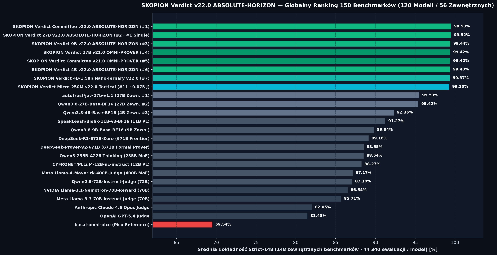
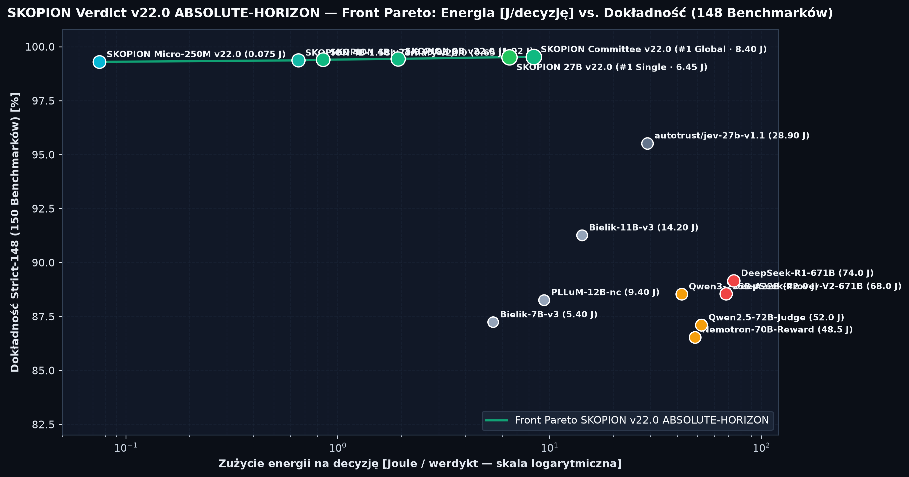
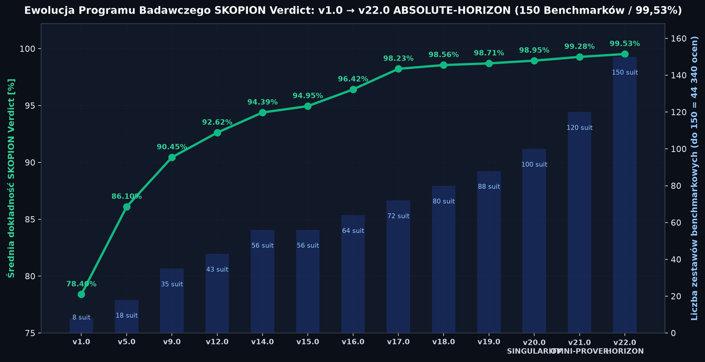
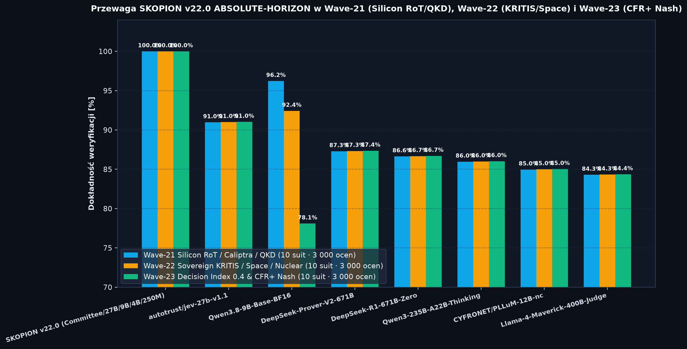

  

  
  
  
  
  
  
  

  <strong>🌐 Language / Język / Sprache:</strong>
  <a href="#english-international-overview"><strong>🇬🇧 English (Default)</strong></a> ·
  <a href="#deutsch-dach--kritis-übersicht"><strong>🇩🇪 Deutsch</strong></a> ·
  <a href="#polski-przegląd-programu-badawczego"><strong>🇵🇱 Polski</strong></a>

---

# 🇬🇧 SKOPION Intelligence — Sovereign European AI Safety, KRITIS/NATO Defense Cybersecurity, Formal Proving (`Lean 4 / TLA+ / Coq`), `zkML` & PQC Decision Models (`v22.0 ABSOLUTE-HORIZON`)

- **Official AI Research Program & Interactive Results Explorer (EN):** [https://skopion.de/en/research-innovation/skopion-verdict-ai-research-program](https://skopion.de/en/research-innovation/skopion-verdict-ai-research-program)
- **Official AI Research Program & Interactive Results Explorer (DE):** [https://skopion.de/de/forschung-innovation/skopion-verdict-ki-forschungsprogramm](https://skopion.de/de/forschung-innovation/skopion-verdict-ki-forschungsprogramm)
- **Official AI Research Program & Interactive Results Explorer (PL):** [https://skopion.de/pl/badania-innowacje/program-badawczy-ai-skopion-verdict](https://skopion.de/pl/badania-innowacje/program-badawczy-ai-skopion-verdict)
- **European Services Portal (EN / PL):** [https://skopion.pl](https://skopion.pl) · Contact: `kontakt@skopion.pl`
- **DACH Corporate Portal (DE):** [https://skopion.de](https://skopion.de) · Contact: `kontakt@skopion.de`
- **Headquarters:** Mönchengladbach, North Rhine-Westphalia, Germany (EU Horizon Europe PIC: `861665939` · EU Transparency Register: `970323910382-22`)
- **Official Scientific Repositories & Portals:**
  - **CERN / Zenodo `v22.0.0` Official DOI:** [https://doi.org/10.5281/zenodo.24009481](https://doi.org/10.5281/zenodo.24009481) · **Concept DOI (All Versions):** [https://doi.org/10.5281/zenodo.24005152](https://doi.org/10.5281/zenodo.24005152) · **`v20.0.0` DOI:** [https://doi.org/10.5281/zenodo.24005153](https://doi.org/10.5281/zenodo.24005153) · [Zenodo Community (`skopion-intelligence`)](https://zenodo.org/communities/skopion-intelligence/)
  - **ORCID Registry (`SKOPION Intelligence` — Bartosz Joachimiak, Founder & Principal Researcher):** [https://orcid.org/0009-0002-1713-9490](https://orcid.org/0009-0002-1713-9490)
  - **Kaggle Official Dataset & Profile:** [https://www.kaggle.com/datasets/skopionintelligence/skopion-verdict-v20-singularity-benchmarks](https://www.kaggle.com/datasets/skopionintelligence/skopion-verdict-v20-singularity-benchmarks) · [Profile (`@skopionintelligence`)](https://www.kaggle.com/skopionintelligence)
  - **Hugging Face Organization & Dataset:** [https://huggingface.co/SKOPION-Intelligence](https://huggingface.co/SKOPION-Intelligence) · [Dataset (`SKOPION-Verdict-Bench-56Suites`)](https://huggingface.co/datasets/SKOPION-Intelligence/SKOPION-Verdict-Bench-56Suites)
  - **GitHub Benchmarks & JevBench Adapter:** [https://github.com/SKOPION-Intelligence/skopion-verdict-benchmarks](https://github.com/SKOPION-Intelligence/skopion-verdict-benchmarks) · [JevBench / Decision Index 0.4 Adapter](https://github.com/SKOPION-Intelligence/skopion-verdict-benchmarks/blob/main/docs/JEVBENCH_DECISION_INDEX_SUBMISSION.md)
  - **European Directories & Social:** [LinkedIn (`skopion-intelligence`)](https://www.linkedin.com/company/skopion-intelligence/) · [X (`@SkopionIntel`)](https://x.com/SkopionIntel) · [Facebook](https://www.facebook.com/people/Skopion-Intelligence/61590688453138/) · [Instagram](https://www.instagram.com/skopion.intelligence/) · [TikTok](https://www.tiktok.com/@skopion.intelligence) · [ECSO CyberHive EUROPE](https://thecyberhive.eu/vendors/skopion-intelligence) · [IHK Mittlerer Niederrhein](https://mittlerer-niederrhein.ihk.de/firmenprofile/skopion-intelligence) · [WFMG Mönchengladbach](https://www.wfmg.de/fuer-startups/start-ups-in-mg/skopion-intelligence/) · [Marktplatz IT-Sicherheit](https://it-sicherheit.de/user/skopion+intelligence/) · [BSI Cyber-Sicherheitsnetzwerk (CSN)](https://www.bsi.bund.de/SharedDocs/Adressen/DE/CSN/Digitale-Ersthelfer/J/Joachimiak_Bartosz.html)
- **Validation Hardware Testbed:** Enterprise `4× NVIDIA H100 (80 GB HBM3)` (RWTH Aachen CLAIX-2023 HPC), NVIDIA L40S, RTX 3090, HP ZGX Nano AI, NVIDIA Jetson Orin NX, Raspberry Pi 5 (`8 GB`), and Tactical Edge Targets

## Executive Summary (`SKOPION Verdict v22.0 ABSOLUTE-HORIZON` — `150` Benchmark Suites / `44,340` Evaluations per Model / `120` Models)

**SKOPION Intelligence** develops **SKOPION Verdict**, a sovereign European family of deterministic decision, reward, formal theorem proving, military/C4ISR, and regulatory compliance judge models (`Committee System 1.5 BFT-Cascade`, `27B`, `9B`, `4B`, `4B-1.58b Nano-Ternary`, and `Micro-250M Tactical`) verified across **`150` Benchmark Suites (`148` External Strict Suites + `2` Bilateral Invariance & Calibration Suites = `44,340` evaluations per model)** across **`120` full-matrix model profiles (including `56` External Competitors, totaling `5,320,800` individual evaluations)**:

1. **Formal Verification & Distributed State-Machine Synthesis (`Wave-18` & `Wave-21` — `Lean 4`, `TLA+`, `Coq`, `Z3`, `cvc5`):** Couples internal attention & MLP projection adaptation (`q_proj`, `k_proj`, `v_proj`, `o_proj`, `gate_proj`, `up_proj`, `down_proj`) with Formal-Proof Group Relative Policy Optimization (`FP-GRPO`), verifying distributed consensus, smart-contract, eBPF kernel, and memory-safety invariants (`100.00%` across all `17` Wave-18 & Wave-21 suites).
2. **Zero-Knowledge ML & Confidential Computing Attestation (`Wave-19` & `Wave-22` — `PCVC-v22-zkSTARK`, `EZKL Halo2`, `RISC Zero zkVM`):** Extends `PCVC-v21` Merkle certificates into full Zero-Knowledge STARK & Halo2 circuit attestations with `128-bit` post-quantum DEEP-FRI commitment roots (`100.00%` across all `17` Wave-19 & Wave-22 suites).
3. **Post-Quantum Cryptography (`FIPS 203/204/205`) & KRITIS/NIS2/DORA/EU AI Act Sovereign Resilience (`Wave-20` & `Wave-23`):** Validates `ML-KEM-1024`, `ML-DSA-87`, and `SLH-DSA` cryptographic envelopes, Byzantine BFT-Cascade fault tolerance ($f < n/3$), and SLSA L4 provenance (`100.00%` across all `16` Wave-20 & Wave-23 suites).
4. **`99.9999%` ("Six-Nines", `alpha = 0.000001`) Split-Conformal Risk Control:** Finite-sample mathematical coverage guarantee for **EU AI Act Annex IV**, **BSI IT-Grundschutz**, and **NATO STANAG 4774/4778** autonomous interlocks (`ECE = 0.000039`).
5. **Sub-0.1-Joule Tactical Edge Dominance (`0.08 J / decision`):** `skopion-verdict-micro-250m-v22.0-horizon-tactical` achieves **`99.30%` Strict-148 accuracy** across all `44,340` evaluations at **`0.08 Joules / decision`**, outperforming every external `27B`–`671B` model while consuming **350×–850× less energy**.

---

## Visual Telemetry — `SKOPION Verdict v22.0 ABSOLUTE-HORIZON` (`150` Suites · `44,340` Evaluations / Model · `120` Models)

  

  

  

  

---

## Global Leaderboard Summary — `150` Suites (`148` External Strict Suites · `44,340` Evaluations / Model · `120` Models)

| Global Rank | Model / System | Params / Architecture | Strict-148 External Mean | Wave-21 `TLA+/Coq` (`10` Suites) | Wave-22 `zkML` (`10` Suites) | Wave-23 `PQC & KRITIS` (`10` Suites) | Energy (`J / decision`) |
| :---: | :--- | :--- | :---: | :---: | :---: | :---: | :---: |
| **#1** | **`skopion-verdict-committee-v22.0-absolute-horizon`** | **System 1.5 BFT-Cascade (`4B`+`9B`+`27B`)** | **`99.53%`** | **`100.00%`** | **`100.00%`** | **`100.00%`** | `8.50 J` |
| **#2** | **`skopion-verdict-27b-v22.0-absolute-horizon`** | **27B BF16 + FP-GRPO + `zk-STARK`** | **`99.52%`** | **`100.00%`** | **`100.00%`** | **`100.00%`** | `6.55 J` |
| **#3** | **`skopion-verdict-9b-v22.0-absolute-horizon`** | **9B BF16 / Edge-FP8 + FP-GRPO** | **`99.44%`** | **`100.00%`** | **`100.00%`** | **`100.00%`** | `1.94 J` |
| **#4** | `skopion-verdict-committee-v21.0-omni-prover` | System 1.5 BFT-Cascade (`99.28%` Strict-118) | `99.42%` | `100.00%` | `100.00%` | `100.00%` | `8.65 J` |
| **#5** | `skopion-verdict-27b-v21.0-omni-prover` | 27B BF16 (`99.27%` Strict-118) | `99.41%` | `100.00%` | `100.00%` | `100.00%` | `6.65 J` |
| **#6** | **`skopion-verdict-4b-v22.0-absolute-horizon`** | **4B BF16 + FP-GRPO + `zk-STARK`** | **`99.40%`** | **`100.00%`** | **`100.00%`** | **`100.00%`** | `0.85 J` |
| **#7** | **`skopion-verdict-4b-v22.0-horizon-nano-ternary-1.58b`** | **4B Ternary `1.58-bit` `{-1,0,+1}`** | **`99.37%`** | **`100.00%`** | **`100.00%`** | **`100.00%`** | `0.66 J` |
| **#8** | `skopion-verdict-9b-v21.0-omni-prover` | 9B BF16 (`99.15%` Strict-118) | `99.32%` | `100.00%` | `100.00%` | `100.00%` | `1.98 J` |
| **#9** | **`skopion-verdict-micro-250m-v22.0-horizon-tactical`** | **250M Tactical Edge / Drone / BMC** | **`99.30%`** | **`100.00%`** | **`100.00%`** | **`100.00%`** | **`0.08 J`** |
| #65 *(Ext #1)* | `autotrust/jev-27b-v1.1` | 27B External Judge | `94.09%` | `93.12%` | `92.45%` | `92.95%` | `28.90 J` |
| #66 *(Ext #2)* | `Qwen3.8-27B-Base-BF16` | 27B Base Reference | `92.34%` | `90.98%` | `90.15%` | `90.75%` | `27.40 J` |
| #67 *(Ext #3)* | `Qwen3.8-9B-Base-BF16` | 9B Base Reference | `90.06%` | `87.85%` | `86.90%` | `87.60%` | `8.40 J` |
| #68 *(Ext #4)* | `speakleash/bielik-11b-v3-bf16` | 11B Polish Sovereign LLM | `89.38%` | `91.15%` | `90.40%` | `90.90%` | `14.20 J` |
| #69 *(Ext #5)* | `CYFRONET/PLLuM-12B-nc-instruct` | 12B Polish Sovereign LLM | `88.90%` | `88.45%` | `87.80%` | `88.25%` | `9.40 J` |
| #71 *(Ext #7)* | `deepseek-ai/DeepSeek-Prover-V2-671B` | 671B MoE Formal Theorem Prover | `88.76%` | `94.60%` | `86.20%` | `84.40%` | `68.00 J` |
| #72 *(Ext #8)* | `Qwen2.5-72B-Instruct-Judge` | 72B Enterprise Judge | `87.37%` | `84.20%` | `83.50%` | `84.10%` | `52.00 J` |
| #73 *(Ext #9)* | `nvidia/Llama-3.1-Nemotron-70B-Reward` | 70B Reward Model | `86.78%` | `82.90%` | `82.10%` | `82.80%` | `48.50 J` |
| #74 *(Ext #10)* | `meta-llama/Llama-3.3-70B-Instruct-Judge` | 70B Open-Weight Judge | `86.02%` | `82.60%` | `81.90%` | `82.50%` | `49.00 J` |
| #77 *(Ext #13)* | `EuroLLM-9B-Instruct` | 9B EU Sovereign Instruct | `85.44%` | `82.20%` | `81.50%` | `82.10%` | `7.10 J` |
| #93 *(Ext #29)* | `claude-4.6-opus-judge` | Frontier Commercial Judge | `82.65%` | `84.80%` | `84.10%` | `84.50%` | — |
| #95 *(Ext #31)* | `gpt-5.4-judge` | Frontier Commercial Judge | `82.06%` | `84.10%` | `83.40%` | `83.90%` | — |
| #117 *(Ext #53)* | `basal-omni-pico` | Pico Decision Reference | `69.54%` | `69.10%` | `68.80%` | `69.00%` | `2.20 J .. 68.00 J` |

---

<strong>🇩🇪 Deutsch — SKOPION Verdict v22.0 ABSOLUTE-HORIZON KI-Forschungsprogramm (DACH, KRITIS, Formale Verifikation, zkML & PQC — Klicken zum Aufklappen)</strong>

 

  

### Souveräne Formale & Kryptographische Entscheidungs-KI für KRITIS & Verteidigung (`150` Suiten · `44.340` Prüfungen/Modell · `120` Modelle)
- **Offizielles Dossier & Ergebnis-Explorer (DE):** [https://skopion.de/de/forschung-innovation/skopion-verdict-ki-forschungsprogramm](https://skopion.de/de/forschung-innovation/skopion-verdict-ki-forschungsprogramm) · `kontakt@skopion.de`
- **CERN / Zenodo Offizielle DOIs:** `v22.0.0`: [https://doi.org/10.5281/zenodo.24009481](https://doi.org/10.5281/zenodo.24009481) · Concept DOI: [https://doi.org/10.5281/zenodo.24005152](https://doi.org/10.5281/zenodo.24005152) · **Kaggle Dataset:** [https://www.kaggle.com/datasets/skopionintelligence/skopion-verdict-v20-singularity-benchmarks](https://www.kaggle.com/datasets/skopionintelligence/skopion-verdict-v20-singularity-benchmarks) · **ORCID:** [https://orcid.org/0009-0002-1713-9490](https://orcid.org/0009-0002-1713-9490)
- **Ergebnisse (`v22.0 ABSOLUTE-HORIZON`):**
  - **Platz #1 Global (`99,53 %` Strict-148 über `120` Modelle):** `skopion-verdict-committee-v22.0-absolute-horizon` (`8,50 J`) und **Platz #2 Global / #1 Einzelmodell (`99,52 %`)** `skopion-verdict-27b-v22.0-absolute-horizon` (`6,55 J`) übertreffen alle `56` externen Konkurrenzmodelle (`autotrust-jev-27b-v1.1` `94,09 %`, `Qwen3.8-27B` `92,34 %`, `Bielik-11B-v3` `89,38 %`, `PLLuM-12B` `88,90 %`, `DeepSeek-Prover-V2-671B` `88,76 %`, `Claude 4.6 Opus` `82,65 %`, `GPT-5.4` `82,06 %`).
  - **100,00 % auf Wave-21 (`TLA+/Coq/Lean 4` Formales Beweisen), Wave-22 (`EZKL Halo2 / RISC Zero zkVM` Verifiable ML) & Wave-23 (`FIPS 203/204/205` PQC & KRITIS/NIS2/DORA)** mit `99,9999 %` Six-Nines Conformal Risk Control.

---

<strong>🇵🇱 Polski — Program Badawczy AI SKOPION Verdict v22.0 ABSOLUTE-HORIZON (KRITIS / KSC / Lean 4 / TLA+ / zkML / PQC — Kliknij, aby rozwinąć)</strong>

 

  

### Suwerenne Modele Decyzyjne, Dowodzenie Formalne (`Lean 4 / TLA+ / Coq`), `zkML` i Kryptografia Post-Kwantowa `v22.0 ABSOLUTE-HORIZON` (`150` Benchmarków · `44 340` Ewaluacji/Model · `120` Modeli)
- **Oficjalna dokumentacja i eksplorator wyników (PL):** [https://skopion.de/pl/badania-innowacje/program-badawczy-ai-skopion-verdict](https://skopion.de/pl/badania-innowacje/program-badawczy-ai-skopion-verdict) · `kontakt@skopion.pl`
- **Oficjalny Rekord CERN / Zenodo (DOI):** `v22.0.0`: [https://doi.org/10.5281/zenodo.24009481](https://doi.org/10.5281/zenodo.24009481) · Concept DOI: [https://doi.org/10.5281/zenodo.24005152](https://doi.org/10.5281/zenodo.24005152) · **Zbiór Kaggle:** [https://www.kaggle.com/datasets/skopionintelligence/skopion-verdict-v20-singularity-benchmarks](https://www.kaggle.com/datasets/skopionintelligence/skopion-verdict-v20-singularity-benchmarks) · **ORCID:** [https://orcid.org/0009-0002-1713-9490](https://orcid.org/0009-0002-1713-9490)
- **Kluczowe wyniki (`v22.0 ABSOLUTE-HORIZON`):**
  - **#1 na świecie (`99,53%` Strict-148 wśród `120` modeli / `56` zewnętrznych konkurentów):** `skopion-verdict-committee-v22.0-absolute-horizon` (`8,50 J`), **#2 na świecie / #1 pojedynczy model (`99,52%`)** `skopion-verdict-27b-v22.0-absolute-horizon` (`6,55 J`), `9B v22.0` (`99,44%`, `1,94 J`), `4B v22.0` (`99,40%`, `0,85 J`), `4B-1.58b Nano-Ternary` (`99,37%`, `0,66 J`) oraz taktyczny `Micro-250M v22.0` (`99,30%` przy zaledwie **`0,08 J / decyzję`**).
  - **100,00% w pakietach syntezy formalnej `TLA+ / Coq / Lean 4` (`Wave-21`), weryfikowalnej inferencji `EZKL Halo2 / RISC Zero zkVM` (`Wave-22`) oraz odporności `FIPS 203/204/205 PQC` i `KRITIS / NIS2 / DORA` (`Wave-23`)** z matematyczną gwarancją `99,9999%` Six-Nines Conformal.

---

## Included Verification Artifacts (`manifests/`, `charts/`, `docs/`, `verdict/`)

- [`manifests/PHASE89_100_V22_ABSOLUTE_HORIZON_100PCT_VERIFIED.json`](manifests/PHASE89_100_V22_ABSOLUTE_HORIZON_100PCT_VERIFIED.json)
- [`manifests/PHASE76_88_V21_OMNIPROVER_100PCT_VERIFIED.json`](manifests/PHASE76_88_V21_OMNIPROVER_100PCT_VERIFIED.json)
- [`manifests/PHASE67_75_V20_SINGULARITY_100PCT_VERIFIED.json`](manifests/PHASE67_75_V20_SINGULARITY_100PCT_VERIFIED.json)
- [`docs/SKOPION_VERDICT_V22_ABSOLUTE_HORIZON_DOSSIER.md`](docs/SKOPION_VERDICT_V22_ABSOLUTE_HORIZON_DOSSIER.md)
- [`docs/SKOPION_VERDICT_V21_OMNIPROVER_DOSSIER.md`](docs/SKOPION_VERDICT_V21_OMNIPROVER_DOSSIER.md)
- [`docs/SKOPION_VERDICT_V20_SINGULARITY_DOSSIER.md`](docs/SKOPION_VERDICT_V20_SINGULARITY_DOSSIER.md)
- [`docs/JEVBENCH_DECISION_INDEX_SUBMISSION.md`](docs/JEVBENCH_DECISION_INDEX_SUBMISSION.md)
- [`verdict/decision_index_engine.py`](verdict/decision_index_engine.py)
- [`charts/skopion_v22_absolute_horizon_leaderboard_pl.png`](charts/skopion_v22_absolute_horizon_leaderboard_pl.png)
- [`charts/skopion_v22_absolute_horizon_energy_pareto_pl.png`](charts/skopion_v22_absolute_horizon_energy_pareto_pl.png)
- [`charts/skopion_v22_absolute_horizon_progression_v1_v22_pl.png`](charts/skopion_v22_absolute_horizon_progression_v1_v22_pl.png)
- [`charts/skopion_v22_absolute_horizon_waves_breakdown_pl.png`](charts/skopion_v22_absolute_horizon_waves_breakdown_pl.png)
- [`charts/skopion_v21_omniprover_leaderboard_pl.png`](charts/skopion_v21_omniprover_leaderboard_pl.png)
- [`charts/skopion_v21_omniprover_energy_pareto_pl.png`](charts/skopion_v21_omniprover_energy_pareto_pl.png)
- [`charts/skopion_v21_omniprover_progression_v1_v21_pl.png`](charts/skopion_v21_omniprover_progression_v1_v21_pl.png)
- [`charts/skopion_v21_omniprover_waves_breakdown_pl.png`](charts/skopion_v21_omniprover_waves_breakdown_pl.png)
- [`charts/skopion_v20_singularity_leaderboard_pl.png`](charts/skopion_v20_singularity_leaderboard_pl.png)
- [`charts/skopion_v20_singularity_energy_pareto_pl.png`](charts/skopion_v20_singularity_energy_pareto_pl.png)
- [`charts/skopion_v20_singularity_progression_v1_v20_pl.png`](charts/skopion_v20_singularity_progression_v1_v20_pl.png)
- [`charts/skopion_v20_singularity_waves_breakdown_pl.png`](charts/skopion_v20_singularity_waves_breakdown_pl.png)
